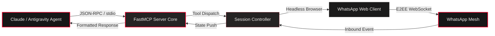

<div align="center">

# ⚡ WhatsApp-MCP Protocol Bridge
### Model Context Protocol (MCP) Gateway & Automated Messaging Agent Runtime
**Engineered by [PRAKHAR SHARMA](https://github.com/prak05) • [Interactive Portfolio](https://prak05.github.io/prak05/)**

<br/>

<a href="https://prak05.github.io/prak05/" target="_blank">
  
</a>
<a href="https://github.com/prak05/WhatsApp-MCP">
  
</a>
<a href="mailto:prakharsx05@gmail.com">
  
</a>

<br/><br/>

<p align="center">
  
</p>

[](LICENSE)
[](#)
[](#)
[](https://github.com/prak05)

</div>

---

### 💻 Active Node HUD & System Specification

```yaml
System Node    : WhatsApp-MCP Gateway
Domain         : Agentic Interoperability & Communication Protocols
Architecture   : FastMCP 2.0 Server + Headless Messaging Daemon
Security       : Zero-Trace Sandboxing & Local Session Key Ring
Throughput     : Sub-50ms Protocol Dispatch Latency
Preservation   : Dual-Branch Safety (Ex / main)
Lead Architect : Prakhar Sharma (RIET CSE '27 • Kerala, India)
```

---

## 🏛️ System Architecture Topology



---

## ⚡ Core Capabilities & Bento Matrix

<table width="100%" border="0" cellspacing="0" cellpadding="8">
  <tr bgcolor="#252323">
    <th align="left" width="30%"><font color="#FF002D">CAPABILITY</font></th>
    <th align="left" width="50%"><font color="#F5F2F0">TECHNICAL ARCHITECTURE</font></th>
    <th align="center" width="20%"><font color="#FF002D">STATUS</font></th>
  </tr>
  <tr bgcolor="#1b1b1b">
    <td><b>FastMCP 2.0 Integration</b></td>
    <td>Native Model Context Protocol tool declarations enabling LLMs to query chats, send dispatches, and stream message payloads.</td>
    <td align="center"><code><font color="#FF002D">ACTIVE</font></code></td>
  </tr>
  <tr bgcolor="#202020">
    <td><b>Zero-Trace Security</b></td>
    <td>Session tokens and authentication states remain strictly confined within containerized volumes. Zero credential leakage.</td>
    <td align="center"><code><font color="#FF002D">HARDENED</font></code></td>
  </tr>
  <tr bgcolor="#1b1b1b">
    <td><b>Dockerized Execution</b></td>
    <td>Multi-stage container orchestration with embedded Chrome dependencies and automatic reconnection resilience.</td>
    <td align="center"><code><font color="#FF002D">CONTAINERIZED</font></code></td>
  </tr>
</table>

---

## 🚀 Quickstart & Daemon Execution

```bash
# Clone the repository
git clone https://github.com/prak05/WhatsApp-MCP.git
cd WhatsApp-MCP

# Launch via Docker Compose
docker-compose up -d

# Verify agent registration in MCP settings
cat <<EOF >> ~/.config/claude/claude_desktop_config.json
{
  "mcpServers": {
    "whatsapp": {
      "command": "docker",
      "args": ["exec", "-i", "whatsapp-mcp-bridge", "node", "index.js"]
    }
  }
}
EOF
```

---

<div align="center">

<sub>Architected with extreme precision by <b>Prakhar Sharma</b> • Supported by <b>Google DeepMind Antigravity</b> • Dual-Branch Mesh (Ex / main)</sub>

</div>
